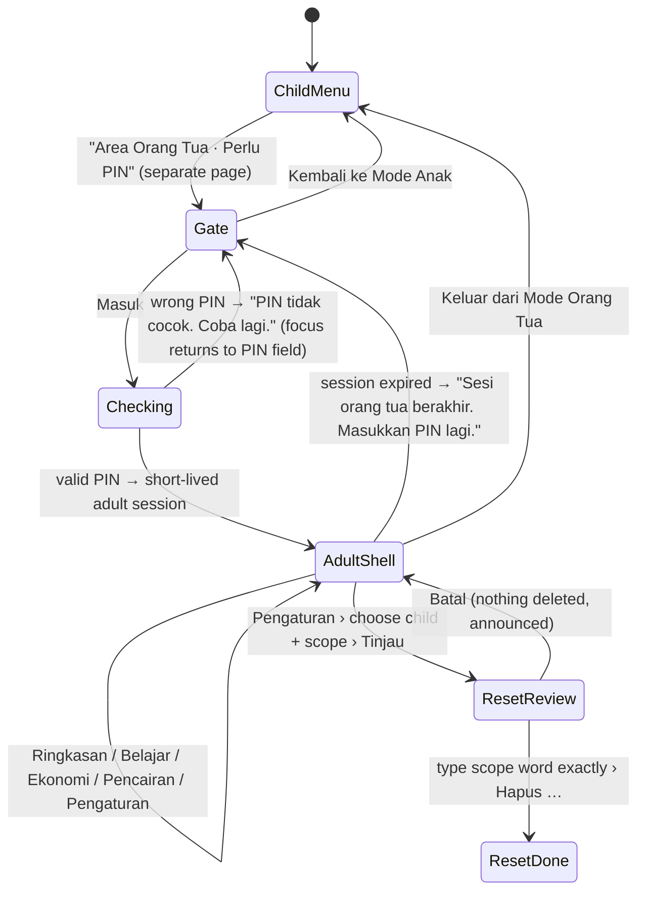

# Adult-gate flow

Sources: PRD §4.4, §6.2, §11.10, AC-09 (with pilot-scope note); pipeline §4.3, §5.2, §6.4; KQ-011 scope.

## 1. Flow

## 2. Separation requirements

| Requirement | Design |
|---|---|
| Not a child action | One labelled menu entry under "Untuk orang tua"; never a tab, badge, or objective |
| Visible mode change | Navy header, "Mode Orang Tua aktif" flag, no child nav, no theme decoration |
| Session | Page memory only in the prototype; a reload asks for the PIN again. Production: PBKDF2 hash, HMAC-signed `HttpOnly`, `SameSite=Strict`, `Secure`-in-production short-lived cookie (KQ-011) |
| Scoped reset | Three scopes, each with its own confirmation word: `HAPUS-KUIS`, `HAPUS-DUNIA`, `HAPUS-SEMUA`; review states child, scope, effect, and irreversibility; the prototype deletes nothing |
| Legacy surfaces | `/stats` stays unchanged in the pilot (AC-09 note); not redesigned here |

## 3. Open item

Wrong-PIN throttling or lockout is not specified in the PRD. The prototype shows only a neutral retry message and invents no lockout rule (conflict C8, owner KQ-011 / lead).
