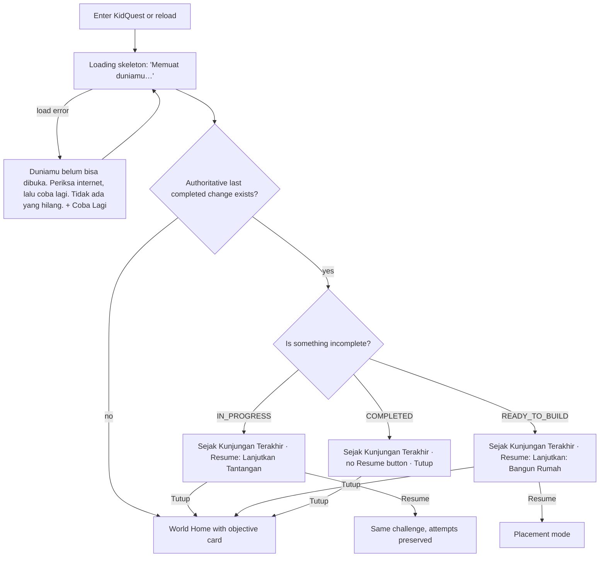
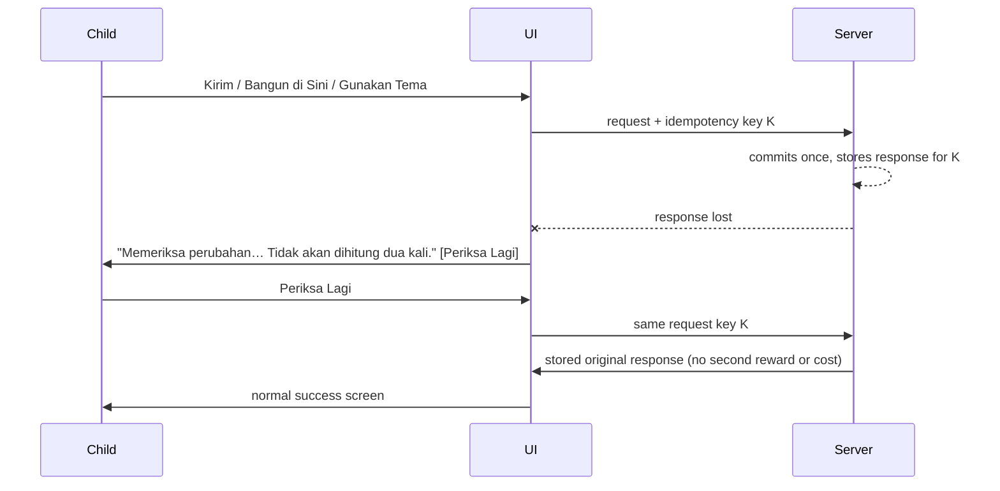

# Calm resume flow

Sources: PRD §7.1–7.3, §11.11, AC-22, AC-28; pipeline §5.4.

## 1. Decision on entry

## 2. Content contract

The summary card replaces the objective card while shown, so the screen keeps exactly one primary action. Dismissing it reveals the objective card with the same recommendation.

| Line | Source | Example |
|---|---|---|
| Last completed change | Server's last committed mutation | Kamu menjawab benar dan mendapat 4 kayu dan cetak biru Rumah. |
| Current authoritative state | Quest state | Sekarang: kayu dan cetak biru sudah siap. Rumah belum dibangun. |
| Safety | Constant | Semua sudah tersimpan otomatis. |
| Resume | Only if a challenge, placement, or tutorial is incomplete | Lanjutkan: Bangun Rumah |

Never shown: days away, missed days, streaks, "kami rindu", countdowns, red badges, or replayed tutorials. Completed tips (the catalog tip and the placement tip) are not replayed. They can be shown again from Bantuan → "Tampilkan lagi petunjuk membangun".

The walkthrough check asserts that the resume card has exactly one primary button, contains no absence or streak vocabulary, and does not replay the completed catalog tip.

## 3. Interrupted mutation ("Memeriksa perubahan")

The walkthrough check proves this in the simulation: after a lost answer response and a recheck, the wood stays at 4 and the attempts at 2. It is not double-credited.
