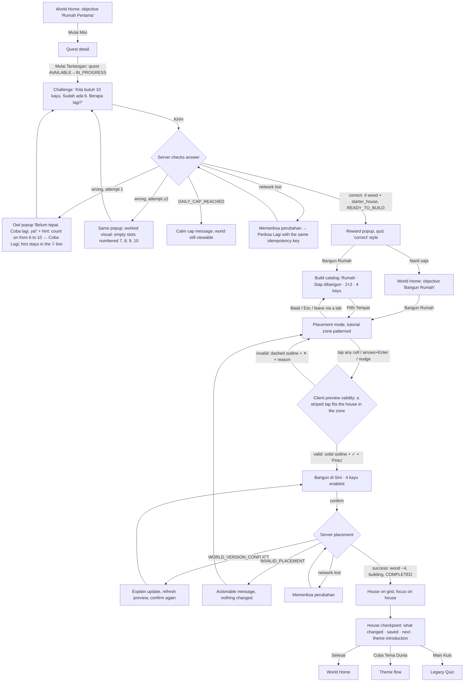

# First-house flow (Q001 → starter house → checkpoint)

Sources: PRD §7, §8.1–8.4, §9.1, §10.2, §11.11–11.12, §12.1–12.3, §12.10; pipeline §5.4, §7.1, §7.3.

## 1. Happy path and recovery



## 2. What each step teaches (one concept at a time)

| Step | Teaches | Explicitly not shown |
|---|---|---|
| First World Home | Current objective; Misi | Wallet, Rp, XP, supplies, roads, themes prompt |
| Quest detail | Story, task, skill, reward kind | The reward amount (it equals the answer; see conflict C2) |
| Challenge | Explicit Submit, hint, safe retry | Timer, speed, penalties, red error colour |
| Reward | Blueprint + starter kit wood; "Hadiahmu sudah tersimpan" | Money, confetti on finance |
| Catalog | Where Bangun lives; cost; footprint; door side | Other buildings beyond one quiet line |
| Placement | Valid/invalid cells and explicit confirm | Free roads, rotation, demolish |
| Checkpoint | What changed, saved automatically, may stop any time, next step, theme is new | Streaks, urgency |

## 3. Authoritative boundaries

| Action | Client may | Server decides |
|---|---|---|
| Start challenge | Show loading on the button | Creates or resumes the one challenge instance |
| Answer | Hold the typed digits; disable Submit while sending | Correctness, attempt count, hint level, reward, quest state |
| Placement preview | Show validity overlay from the layout | Final validity, version, cost, collision; creates building |
| Confirm placement | Keep the idempotency key for the intent | Commit once; replay returns the original response |

A new origin selection is a new intent and gets a new idempotency key. Re-checking after a lost response reuses the original key.

## 4. Refresh and interruption safe points

| Interrupted at | On return |
|---|---|
| Quest detail, before start | World Home, objective "Mulai Misi"; no summary (nothing completed) |
| Challenge, after ≥1 attempt | Sejak Kunjungan Terakhir: attempts saved; Resume = "Lanjutkan Tantangan" (same challenge, no new instance) |
| Reward screen | Summary: got 4 wood + blueprint; Resume = "Lanjutkan: Bangun Rumah" |
| Placement preview (not confirmed) | Same as reward; the preview is discarded because it was never committed |
| After house | Summary: house built; no Resume (nothing incomplete); objective per IA priority |

## 5. Placement geometry (canonical `pulau_tunas_v1`, reconciled 2026-11-22, C3)

Source: `content/kidquest/layouts/pulau_tunas_v1.json` (content_version 1); convention in `content/kidquest/README.md`. (0,0) is the north-west corner, x grows east, y grows south, and a position is the footprint's top-left cell.

```text
      x→  0  1  2  3  4  5  6  7
  y↓ 0    T  .  .  .  .  .  .  T      T tree   R rock   Q quest board
     1    .  t  t  t  t  .  .  .      ~ water  B bridge_zone (water)
     2    .  t  t  t  t  .  .  .      t tutorial_zone x1–4, y1–2
     3    .  .  .  .  Q  .  .  .      e expansion_zone x4–7, y6–7 (locked, Q005)
     4    .  .  .  ~  ~  B  ~  ~
     5    .  .  .  ~  ~  B  ~  ~      Starter house: 2×2, rotation 0, door south.
     6    .  .  .  ~  e  e  e  e      Valid Q001 origins: (1,1), (2,1), (3,1).
     7    R  .  .  ~  e  e  e  T
```

- **Tap mapping (D11, proposal):**
  - Inside the zone: a tap on any striped cell picks the origin whose 2×2 footprint covers that cell and fits the zone, for example (4,2) → (3,1).
  - Outside the zone: the tapped cell is the origin, so the reason is concrete (tree, rock, water, board, locked area, or outside the stripes).
  - The request always sends the top-left origin, per the content convention.
- **Invalid-reason priority:** out of bounds → fixed object (tree/rock/board) or building → water → locked expansion area → outside the tutorial zone.
