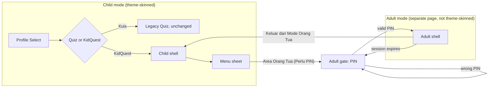
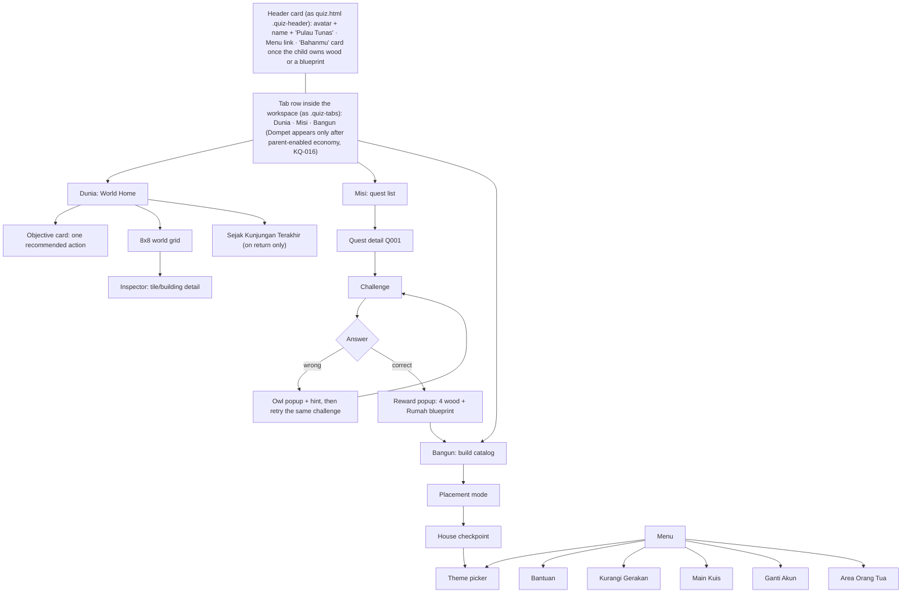
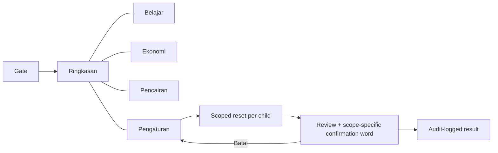

# Child and parent information architecture (first-house release)

Status: KQ-005 low-fidelity specification. Sources: PRD §6, §7.1–7.2, §11.1, §11.10–11.12; pipeline §4.3, §5.1–5.5, §6.

## 1. Mode separation

Rules:

- Parent functions never appear as child actions. The only child-side affordance is one labelled menu entry below an "Untuk orang tua" divider, which opens a separate page (`parent.html` in the prototype).
- The adult shell uses the app's Statistics page styling (`stats.html`), a persistent gold "Mode Orang Tua aktif" flag, and no child navigation, so a parent cannot believe they are still in child mode. Ekonomi and Pencairan are absent while the economy is disabled (C7).
- The adult session is short-lived. Expiry returns to the gate with an explanation, not to child mode.

## 2. Child shell

### Navigation ownership

| Destination | Contains | Selected for views |
|---|---|---|
| Dunia | World Home, inspector, house checkpoint, theme picker | `world`, `checkpoint`, `theme` |
| Misi | Quest list, Q001 detail, challenge, reward | `missions`, `quest`, `challenge`, `reward` |
| Bangun | Build catalog, placement mode | `catalog`, `place` |
| Menu (not a tab) | Tema Dunia, Kurangi Gerakan, Bantuan, Main Kuis, Ganti Akun, Area Orang Tua | — |

The first-house shell has exactly three balanced destinations. There is no empty fourth slot and no locked "Dompet" tab (pipeline §5.1, §5.5).

### Recommended-objective priority (PRD §7.1)

| Authoritative state | Objective card | Primary action |
|---|---|---|
| Q001 `AVAILABLE` | Misi sekarang · Rumah Pertama | Mulai Misi → quest detail |
| Q001 `IN_PROGRESS` | Tantangan belum selesai | Lanjutkan Tantangan → same challenge |
| Q001 `READY_TO_BUILD` | Bangun Rumah | Bangun Rumah → placement |
| `COMPLETED`, economy on | Misi berikutnya · Kebun Tunas | Lihat Misi (Q002 is out of KQ-005 scope) |
| `COMPLETED`, economy off, theme not yet introduced | Baru · Tema Dunia | Coba Tema Dunia (secondary: Nanti saja) |
| `COMPLETED`, economy off, theme introduced | Lengkap untuk sekarang | Main Kuis (optional practice) |

On tablet/desktop, non-home views show a compact objective card in the left column without a button, so one view never has two competing primary actions.

## 3. Adult shell

| Section | First-house content | Later owner |
|---|---|---|
| Ringkasan | Per-child Q001 status, house built, attempts, hints, theme; "Tidak ada keputusan yang menunggu" | KQ-011 |
| Belajar | 7-day skill evidence (Pengurangan dasar), attempts, hints, one deterministic practice suggestion | KQ-011, KQ-024 |
| Ekonomi | Explanatory empty state: economy not enabled in this release | KQ-016 |
| Pencairan | Explanatory empty state: no requests; approve and mark-paid will be separate | KQ-015, KQ-016 |
| Pengaturan | Scoped reset with three scopes, each with its own confirmation word | KQ-011 |

See the decision log, conflict C7, on whether Ekonomi and Pencairan should instead be hidden until the economy is enabled.
