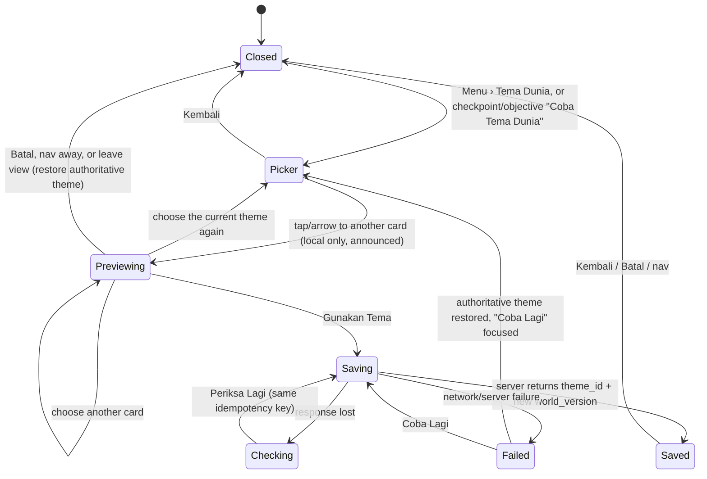

# Theme-switch flow

Sources: PRD §8.4, §11.3, §11.11, §12.4, AC-13; pipeline §2, §7.2.

## 1. Flow

## 2. Rules carried by the design

- The picker is introduced only after the house checkpoint. "Tema Dunia" exists in the Menu from first load (all themes are available, PRD §11.3) but is never promoted before the house (conflict C5 records this interpretation).
- Three large radio cards: thumbnail, name, and a text mark: "Dipakai" (authoritative), "Dilihat" (preview), or "Gratis". Selection is shown by a 3 px outline (the quiz's `.is-selected` purple) and the text mark, not by colour alone.
- Preview changes terrain colours, quest-board label, and the building silhouette together. It never changes positions, footprints, hit areas, wood, blueprints, quest state, or attempts. The walkthrough check measures the four house cells' grid-relative rectangles before and during preview and asserts they are identical.
- A banner above the world says "Pratinjau: <tema>. Belum dipakai." while previewing.
- "Gunakan Tema" is disabled when no different theme is being previewed, with visible helper text.
- No currency, price, or lock appears anywhere in the picker. Every card says "Gratis" or is already in use.
- On phone and tablet, the cards and the Gunakan Tema / Batal buttons sit in a fixed action bar at the bottom, so the whole world stays visible during preview.
- The theme repaints only the world canvas and the picker thumbnails. The header, tabs, panels and buttons keep the existing app's dark shell and the child's accent (pipeline §8.2a).

## 3. Copy

| Moment | Child-facing text |
|---|---|
| Picker intro | Lihat pulaumu dengan gaya lain. Semua tema **gratis**. Rumah, kayu, dan misimu tidak berubah. |
| Live announcement | Pratinjau Kerajaan Ceria. Bangunan tetap di tempat yang sama. Belum dipakai. |
| Success | Tema Kerajaan Ceria dipakai. Rumahmu tetap di tempat yang sama. |
| Failure | Tema belum tersimpan. Tampilan kembali ke Kampung Ceria. Duniamu tidak berubah. [Coba Lagi] |
| Tap the world during preview | Ini pratinjau tema. Tekan Gunakan Tema atau Batal. |

Theme names: `perkampungan` = Kampung Ceria (default), `kingdom` = Kerajaan Ceria, `city` = Kota Ceria. The house and quest-board names per theme are drafts that need household content review (finding F9).
